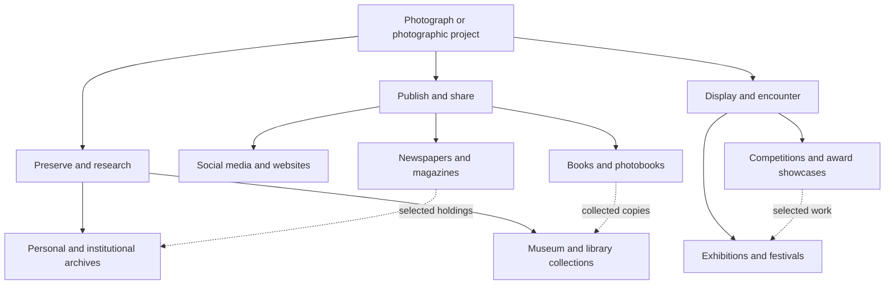

# Photography Genres & Careers

Photography combines observation, visual storytelling, technical control and collaboration. A genre describes the subject or approach; a career describes how someone earns a living from that work. The two overlap: a portrait photographer might work for families, newspapers, companies and galleries.

## Main genres: challenges and techniques

The settings below are starting points. Light, subject movement and the intended result determine the final choices. For the underlying controls, see [Equipment & Settings](03_equipment_%26_settings.md).

| Genre | Main challenges | Associated techniques |
| --- | --- | --- |
| **Portrait** | Helping people feel comfortable; choosing a background; keeping attention on the subject. | Build rapport, give clear direction, focus on the eyes and use window light or a soft light source. Choose depth of field carefully, especially for groups. |
| **Landscape** | Changing weather, bright skies, finding depth and avoiding an unfocused composition. | Scout locations, observe the direction of light and use foreground, middle distance and background. A tripod supports slow exposures; exposure bracketing can help with a large brightness range when the scene allows it. |
| **Street** | Unpredictable gestures, cluttered backgrounds and photographing people respectfully. | Anticipate movement, watch the edges of the frame and pre-focus or use responsive autofocus. Work with layers, reflections and the relationship between people and their surroundings. |
| **Architectural and interiors** | Converging vertical lines, cramped rooms, mixed lighting and representing space accurately. | Keep the camera level when straight verticals matter; use a shift lens or careful perspective correction. Plan around sunlight, use a tripod and avoid stretching rooms with excessive wide-angle framing. |
| **Sports** | Fast action, brief decisive moments, difficult light and distracting backgrounds. | Learn the sport, anticipate key positions and use continuous autofocus. Try a fast shutter speed to freeze action or pan with a slower speed to convey movement; use short bursts selectively. |
| **Wildlife** | Unpredictable animals, distance, low light and avoiding disturbance. | Learn behaviour, wait patiently and use a suitable working distance. Continuous autofocus and fast shutter speeds help with action; support long lenses and prioritise the animal's welfare over the photograph. |
| **Macro and close-up** | Very shallow depth of field, tiny movements and difficult lighting. | Focus precisely, stabilise the camera and diffuse the light. Focus stacking combines different focus distances for stationary subjects; wind and moving insects can make it unsuitable. |
| **Documentary and photojournalism** | Gaining access, understanding context, accurate captions and telling a fair story under pressure. | Research the subject, record names and dates, and combine establishing views, details and human moments. Preserve factual content and follow the publication's rules on staging and editing. |
| **Wedding and events** | Unrepeatable moments, changing light, crowded spaces and strict schedules. | Plan a timeline, anticipate interactions and combine candid observation with directed groups. Practise flash, prepare spare batteries and cards, and arrange equipment backup for paid assignments. |
| **Fashion and beauty** | Coordinating styling, posing, lighting and a consistent creative concept. | Work from a brief or mood board with models, stylists and makeup artists. Control light and colour, direct poses and agree on the intended degree of retouching. |
| **Product, food and still life** | Reflections, accurate colour, texture and meeting a client's brief. | Shape light with diffusers, reflectors and flags; refine composition on a tripod. Tethering to a computer helps inspect details. Use controlled colour and selective focus or stacking as needed. |
| **Fine art and conceptual** | Developing a coherent idea and making presentation support its meaning. | Research, experiment and build a series. Staging, alternative processes, montage and unusual printing can serve the concept; explain the process where it affects interpretation. |
| **Scientific and technical** | Repeatability, scale, consistent conditions and reliable records. | Use controlled illumination, scale references, documented settings and calibrated workflows. Specialist work may require microscopy or other domain-specific equipment and training. |

Genres are flexible. A series about an Alpine village might combine landscape, portrait, architecture and documentary photography. Technique should support the story rather than become a checklist of effects.

## Photographers who influenced the field

These examples offer different ways to think about photographs rather than a complete ranking of influential artists. The final column suggests a practical lesson to explore in your own work.

| Photographer | Contribution and work to explore | What to study |
| --- | --- | --- |
| **Julia Margaret Cameron** | Her expressive Victorian portraits and literary tableaux helped establish photography as an artistic medium. She used selective focus and dramatic presentation rather than treating technical sharpness as the only goal. [The Met: Cameron](https://www.metmuseum.org/essays/julia-margaret-cameron-1815-1879). | How light, expression and softness can create mood. |
| **Ansel Adams** | His landscapes and carefully controlled prints made tonal interpretation central to his practice. His idea of visualisation connected the exposure with the intended final print. [SFMOMA: Adams](https://www.sfmoma.org/artist/Ansel_Adams/?pg-artwork=12). | Plan how light and dark areas should feel in the finished image. |
| **Dorothea Lange** | Her work on the Great Depression, including *Migrant Mother* (1936), became a defining example of socially engaged documentary photography. [MoMA: Migrant Mother](https://www.moma.org/momaorg/shared/flattened_pages/moma_learning/dorothea-lange-migrant-mother-nipomo-california-1936/). | Consider the human story, the caption and what the frame leaves outside. |
| **Henri Cartier-Bresson** | A co-founder of Magnum Photos, he connected spontaneous observation with precise composition. His book *The Decisive Moment* became a reference for street photography and reportage. [Magnum: biography](https://pro.magnumphotos.com/C.aspx?ERID=24KL53ZMYN&VF=MAGO31_9_VForm&VP3=CMS3). | Anticipate how gesture and geometry can come together. |
| **Robert Frank** | The Swiss-born photographer's *The Americans*, first published in France in 1958, offered a personal, questioning view of American life. His photographic books also show how editing and sequencing create meaning. [National Gallery of Art: Frank collection](https://www.nga.gov/artists/robert-frank-collection). | Read a sequence as a whole, including contrasts and recurring motifs. |
| **Cindy Sherman** | In *Untitled Film Stills*, she staged herself as fictional film characters to examine familiar representations of women. [MoMA: Sherman](https://www.moma.org/momaorg/shared/flattened_pages/moma_learning/cindy-sherman-untitled-film-stills-1977-80/). | Examine how costume, setting and framing construct an identity. |
| **Zanele Muholi** | Their photographic and activist practice gives visibility to Black LGBTQIA+ lives, challenging stereotyped representations and building a record of community and identity. [Tate: Muholi exhibition book](https://shop.tate.org.uk/zanele-muholi-exhibition-book/24734.html). | Think about who makes an image, who is represented and how participants shape their portrayal. |

## Education and training

There are several routes into photography. Compare the kind of work you want to develop, the teaching approach, practical facilities, feedback, language, time commitment and cost. A qualification and a strong portfolio serve different purposes; practical experience remains valuable in every route.

### Formal routes in Switzerland

| Route | What it offers | Verified example |
| --- | --- | --- |
| **Vocational education: photographer CFC / EFZ** | Practical professional training through an apprenticeship or a full-time school route. The standard programme lasts four years and includes image production, postproduction and business tasks. | [Swiss careers guidance: Photographe CFC](https://www.orientation.ch/web_file/getbb?id=28174&mime=application%2Fpdf&original_name=Photographe_CFC_223.pdf). |
| **Full-time vocational school** | Structured technical and creative study with professional experience. | [CEPV, Vevey](https://www.cepv.ch/formation/cfc-photographe-apprentissage-ecole-art/) offers a four-year photographer CFC programme including a six-month placement in its final year. |
| **Bachelor's degree** | Sustained project development, photographic history and theory, critique, publications and commissioned work. | [ECAL Bachelor Photography](https://ecal.ch/en/courses-and-research/bachelor/bachelor-photography/), in Renens/Lausanne. |
| **Master's degree** | Advanced development of an individual practice and longer projects, building on relevant previous study. | [ECAL Master Photography](https://ecal.ch/en/courses-and-research/master/master-photography/) is a two-year programme for students with a related bachelor's degree. |

Admission procedures, accepted qualifications and programme details vary. Consult the linked institutions for the current requirements.

### Workshops, assisting and independent learning

Short courses can target lighting, editing, printing, visual storytelling or book design. The [Centre de la photographie Genève](https://www.centrephotogeneve.ch/pages/photographers) offers workshops, mentorship activities and portfolio feedback. Museums and festivals also provide talks and opportunities to discuss work with other photographers.

Assisting a working photographer teaches preparation, lighting, collaboration and delivery. Independent study can be structured around a specific project: make a series, edit it, ask for critique, revise it and produce a finished outcome. Learn file organisation, backups, captions and basic business administration alongside camera technique.

### Turning skills into a career

Professional work can include freelance assignments, staff positions, running a studio, licensing photographs, print sales, teaching or a combination of activities. Related roles include retouching, picture editing, assisting, printing, curating and photographic archiving; some require additional specialist training.

A practical starting sequence is to:

1. Choose a small project or a client type and develop relevant work.
2. Build a concise portfolio showing consistent quality and a clear point of view.
3. Practise working to a brief, schedule and delivery specification.
4. Learn to estimate preparation, shooting, editing, expenses and administration when pricing a job.
5. Agree in writing on deliverables, permitted uses, payment and deadlines.
6. Maintain professional relationships and update the portfolio as your work develops.

Visibility can help people discover your work, but paid work also depends on trust, reliability, clear communication and a service that meets a real need.

## The photography landscape in Switzerland

Switzerland's photography scene connects cultural institutions, vocational and art schools, publishers, festivals, professional organisations and independent practitioners. The following examples provide entry points across different language regions; they are not an exhaustive directory.

### Museums, collections and exhibition spaces

| Institution | Location | Role in photography |
| --- | --- | --- |
| **Photo Elysée** | Lausanne | A museum devoted to photography, with exhibitions and work on collecting, documenting, conserving and digitising photographic materials. [Museum](https://elysee.ch/en/museum/) and [collections](https://elysee.ch/en/collections/). |
| **Fotomuseum Winterthur** | Winterthur | Exhibitions, collecting and discussion focused on contemporary photography and visual culture, including the effects of digital technologies. [About the museum](https://www.fotomuseum.ch/en/ueber-uns/). |
| **Fotostiftung Schweiz** | Winterthur | Preserves, researches and presents photographic heritage with a Swiss connection. It also runs a specialist public library with Fotomuseum Winterthur. [Institution](https://fotostiftung.ch/en/foundation/institution/). |
| **Centre de la photographie Genève** | Geneva | Exhibitions and education around contemporary photography, alongside activities for artists and photographers. [About the centre](https://www.centrephotogeneve.ch/pages/about). |

### Festivals and encounters

- **[Biennale Images Vevey](https://www.images.ch/en/information/):** Photographic installations appear in public spaces as well as museums and galleries. Its biennial format brings images into everyday urban settings.
- **[Verzasca Foto](https://www.verzascafoto.com/):** Connects emerging international photography with the landscape and communities of Ticino's Verzasca Valley through exhibitions and encounters. The organiser states that the festival becomes biennial from its 2027 edition.
- **[Swiss Photomonth](https://www.swissphotomonth.ch/information):** A national initiative connecting photography venues and events, useful for discovering institutions beyond your own region.

### Professional networks

**[SIYU professionelle fotografie schweiz](https://www.siyu.ch/)** represents photographers' professional interests and offers member activities and resources. Older references may use SBF, USPP or vfg: these organisations came together under SIYU, as documented in its [2024 statutes](https://www.sbf.ch/fileadmin/Content/Dokumente_Recht_public/Statuten_2024/Statuten_CH/Statuten_SIYU_professionelle_fotografie_schweiz_06_2024.pdf).

**[Photojournalistes suisses / Swiss photojournalists within impressum](https://www.photojournalists.ch/)** provides a professional network, industry information and resources concerning the working conditions and practice of photojournalism.

For newcomers, exhibitions, public talks and portfolio reviews offer ways to understand the field and meet practitioners. For professional assignments, a relevant portfolio and the ability to work with editors, clients and production teams are as important as knowing the institutions.

## Where photographs are published, displayed and preserved

A photograph can have several lives. The same project might first appear on a website, later become a magazine story, then develop into a photobook or exhibition. Some photographs eventually enter an archive or collection. These routes overlap and do not form a compulsory career ladder.

### A map of photographic circulation

*This diagram shows possible relationships, not audience sizes, market shares or a guarantee that published work will be collected. The table below provides the same categories for readers whose Markdown viewer does not render Mermaid.*

| Channel | What it is useful for | What photographers prepare or consider |
| --- | --- | --- |
| **Social media** | Discovery, discussion, short series and contact with a community. | Screen-sized exports, useful captions, accessible descriptions and a link to a fuller project. Platform presentation and visibility can change; keep your own originals and records. |
| **Personal and editorial websites** | A portfolio, an extended story, a searchable project or direct contact with clients. | A clear sequence, readable context, image credits, contact information and files sized for fast loading. |
| **Newspapers** | Timely reporting, public-interest stories and local coverage, in print and online. | Verified captions, accurate context, quick delivery and compliance with editorial standards. |
| **Magazines** | Features, fashion, specialist subjects and sustained visual stories. | A focused pitch or response to a brief, a coherent selection and files suitable for the page design. |
| **Books and photobooks** | An extended sequence with deliberate pacing and a physical or digital form. | Editing, page order, text, design, proofing, printing and distribution. Production and sales costs need planning. |
| **Exhibitions and festivals** | Viewing scale, material, space and relationships between images. | Print tests, display sizes, framing or mounting, captions, installation planning and a budget. |
| **Competitions** | Selection by a jury and possible publication, exhibition or professional recognition. | Work that fits the category, an accurate statement and files meeting the rules. Shortlisting does not guarantee income. |
| **Archives, libraries and museum collections** | Long-term documentation, research and cultural memory. | Identified files or objects, dates, captions, provenance and clear rights records. Institutions select material according to their collecting policies. |

**Publication and preservation need different workflows.** A social media upload is a distribution copy. Preservation requires keeping original captures and high-quality masters, maintaining metadata, making independent backups and checking that files remain readable. Physical prints and negatives need appropriate storage and handling. Photo Elysée's [collection work](https://elysee.ch/en/collections/) illustrates how cataloguing, conservation and digitisation support long-term access.

**Example:** A documentary project on a Swiss neighbourhood could become a local newspaper feature, a longer website story, a community exhibition and a photobook. A local archive might later accept selected materials if they fit its collection. Each version needs its own edit and supporting information.

## Well-known photography competitions and awards

Competitions differ in purpose: some recognise completed images, while others support a project still to be made. Use the current organiser's rules for eligibility, dates, fees and permitted editing; these change between editions.

| Competition or award | Focus | Who or what it is suited to |
| --- | --- | --- |
| **[World Press Photo Contest](https://www.worldpressphoto.org/contest/entry-rules)** | Photojournalism and documentary photography. | Professional photographers who can provide the required evidence of professional status. Accuracy, captions and image verification are central. |
| **[Sony World Photography Awards](https://www.worldphoto.org/sony-world-photography-awards)** | A broad range of photographic subjects and approaches. | Routes for individual images, series, students and young photographers. The current programme uses the names Single Image and Series, previously Open and Professional. |
| **[Wildlife Photographer of the Year](https://www.nhm.ac.uk/wildlife-photographer-of-the-year/competition.html)** | Wildlife, nature and our relationship with the natural world; organised by London's Natural History Museum. | Adult and young photographers, with separate competition rules. Animal welfare and faithful information about the photograph matter alongside visual quality. |
| **[Swiss Press Photo](https://swisspressaward.ch/en/)** | Press photography in the Swiss media landscape. | Freelance and staff photographers whose work meets the edition's publication and eligibility conditions. |
| **[Grand Prix Images Vevey](https://www.images.ch/en/information/)** | Support for developing a new photographic project. | A project proposal: the award supports production, with the resulting work presented at the subsequent biennale. This differs from submitting a finished single image. |

Before entering, check the theme, eligible capture or publication period, age or professional requirements, entry cost, judging process and rights granted to the organiser. Check rules for staging, composites, AI tools and editing rather than assuming all competitions apply the same standard. Retain original files and accurate captions if verification is required.

Competition results are one form of feedback. A coherent body of work, thoughtful presentation and sustained relationships also contribute to a photography career.

---

*Institutional and programme information checked on 26 November 2026. Linked official sources provide current admission requirements, programmes and competition conditions.*
