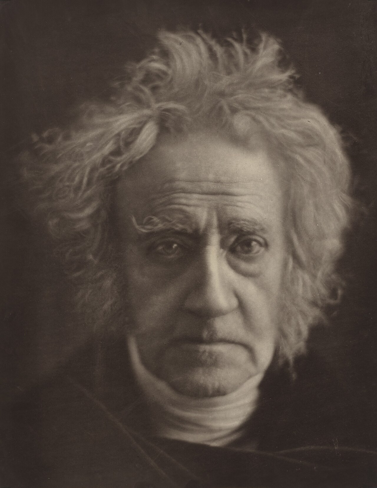
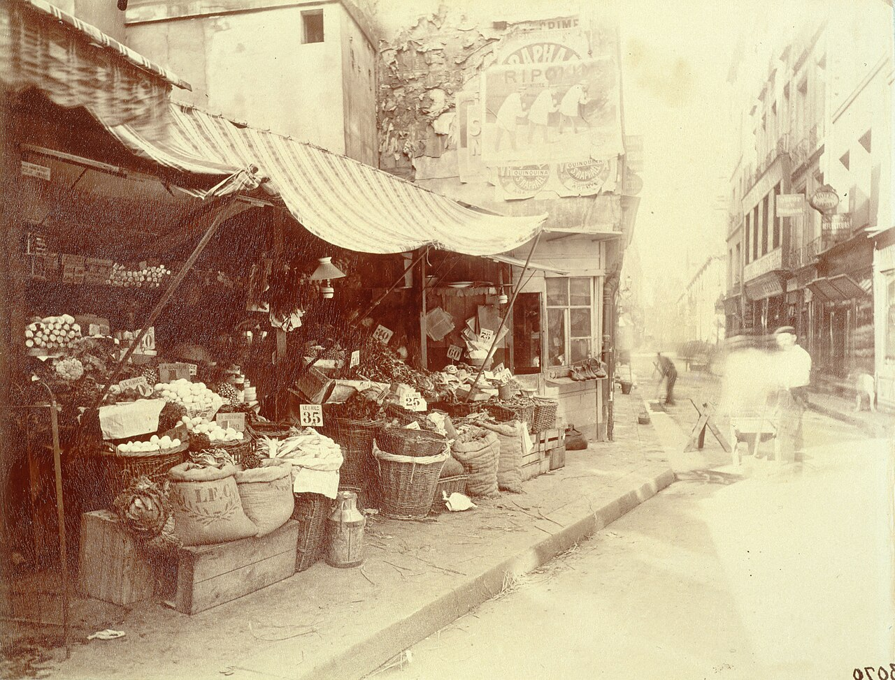
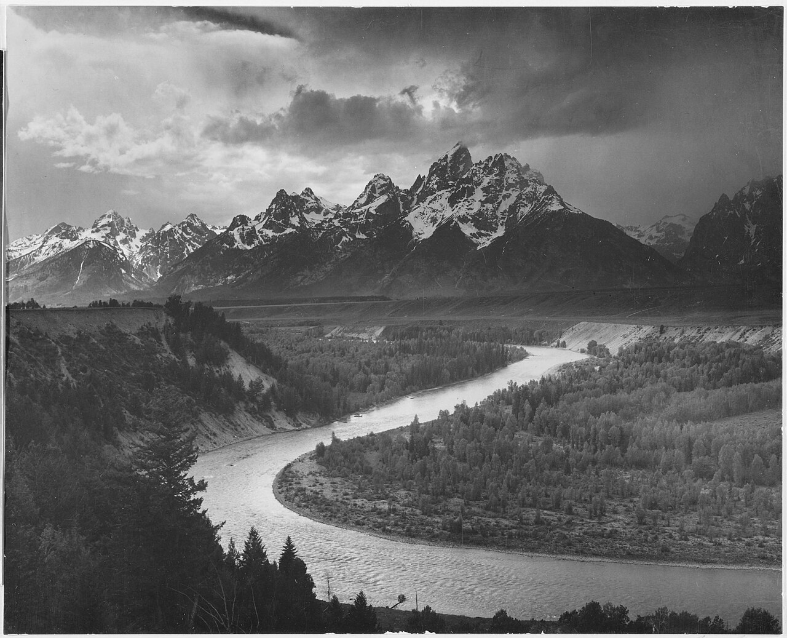
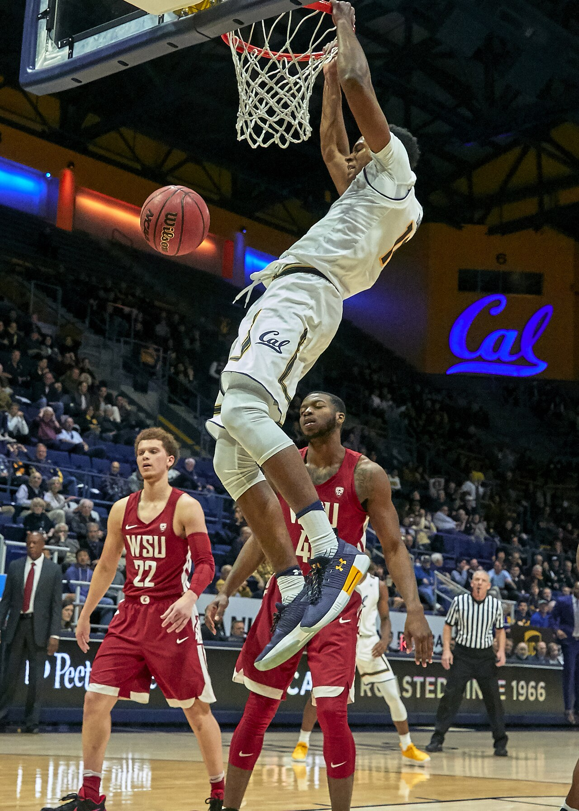
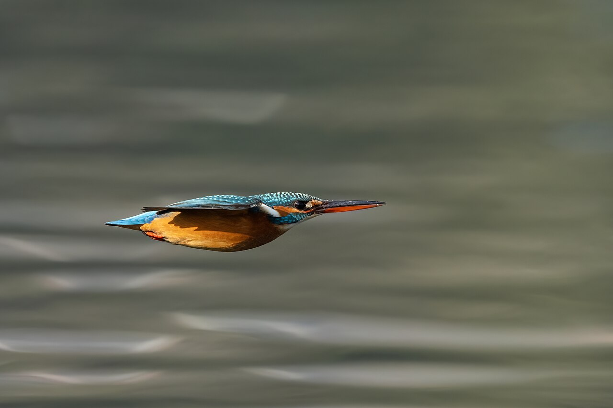
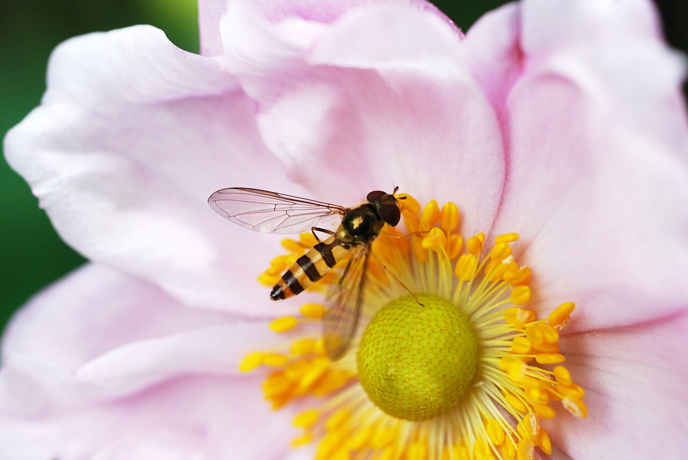
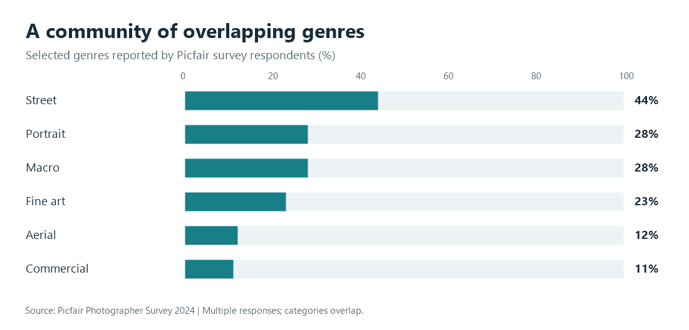
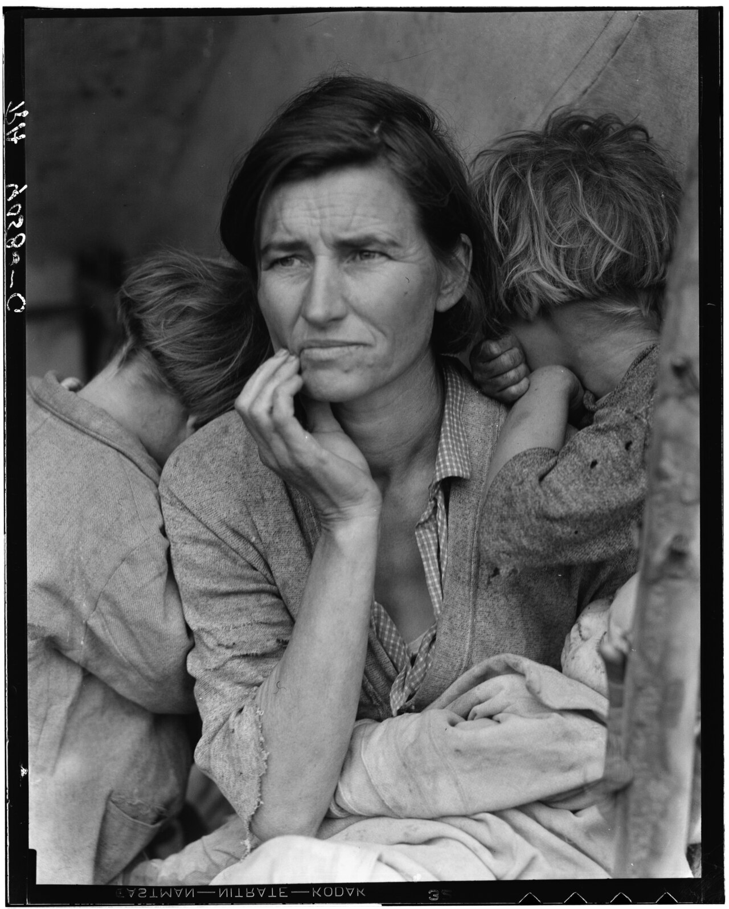
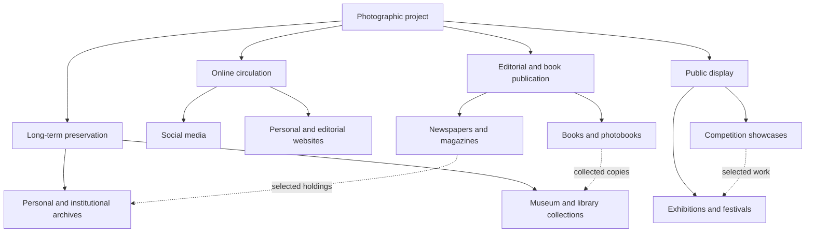
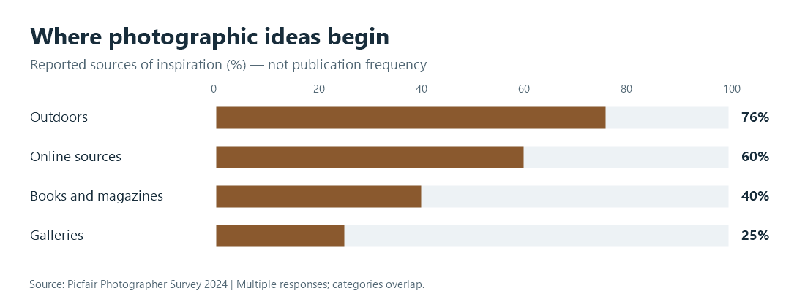

# Photography Genres & Careers

A photograph of a person can be a family keepsake, a newspaper illustration, an advertisement or a work of art. Its subject alone does not explain what it does. The circumstances of its making, the relationship between photographer and subject, and the place where it is encountered all contribute to its meaning. Photography's genres and careers emerge from these relationships: between observation and invention, personal expression and commissioned work, immediate communication and lasting memory.

The boundaries remain permeable. A photographer documenting an Alpine community may move from portraits to interiors, from a sporting event to the surrounding landscape. The resulting pictures can belong to several genres while forming a single coherent project. Genres are therefore useful as traditions of looking and working, rather than fixed compartments.

## Subjects, approaches and photographic choices

### People: encounter, observation and performance

Portraiture begins with an encounter. Expression, gesture, clothing and surroundings can suggest something about a person, but they also reveal decisions made by the photographer. A close portrait against a plain background directs attention towards the face; an environmental portrait allows a workshop, kitchen or office to become part of the account. Lighting affects that relationship as much as composition. Broad, soft illumination can describe a face gently, while a smaller or more directional source gives shadows greater presence. Depth of field determines how much of the surrounding world remains legible; in a group, very shallow focus may exclude people whose faces fall behind the focus plane. The technical principles are developed in [Equipment & Settings](03_equipment_%26_settings.md).

*Photograph 1 — Portraiture. Julia Margaret Cameron, Sir John Herschel, 1867. The close framing and directional light give the face a sculptural presence, while the softer hair and clothing keep attention on the expression. Credit: Julia Margaret Cameron / MoMA, via Wikimedia Commons; public domain. [29](#ref-29)*

Street photography shifts the balance towards situations that unfold without direction. Its subject may be a gesture, an unexpected alignment or a brief relationship between strangers and the city. The challenge is often less the speed of the shutter than the speed of recognition: a background becomes meaningful only when someone enters it. Anticipation, pre-focusing and responsive autofocus support this way of working, but attention to the people in the picture remains essential. An image made in public can still expose vulnerability or invite an interpretation the subject would not recognise.

*Photograph 2 — Street and urban documentary photography. Eugène Atget, Coin de la rue Vauvillers, 1898. The shop, pavement and passing figures become a record of everyday urban life. The blurred people also show how movement can remain visible within an otherwise detailed scene. Credit: Eugène Atget / Musée Carnavalet, Paris Musées, via Wikimedia Commons; CC0. [30](#ref-30)*

Wedding and event photography combines these observational demands with an obligation to particular people. A ceremony or performance cannot simply be repeated because a photograph failed. The photographer moves between candid interactions, organised groups and the practical constraints of a schedule, often under mixed or rapidly changing light. Fashion and beauty photography usually allow more deliberate construction. Styling, pose, makeup, lighting and retouching work together to produce a visual proposition, making the photograph a collaboration as much as an individual act.

### Places: landscape and the built environment

Landscape photography turns space into a composition. Light, weather and viewpoint determine whether a mountain appears monumental, remote, familiar or altered by human activity. Foreground detail can establish scale, while the relationship between near and distant forms creates depth. A tripod permits long exposures that transform moving water or clouds; exposure bracketing records different brightness ranges for scenes whose highlights and shadows cannot be retained satisfactorily in one capture. Moving foliage, waves and changing light can complicate the combination of those exposures.

*Photograph 3 — Landscape. Ansel Adams, The Tetons and the Snake River, 1942. The bright river leads the eye from the foreground towards the mountains; the dark woodland and luminous clouds establish a wide range of tones. Credit: Ansel Adams / U.S. National Archives, 79-AA-G01, via Wikimedia Commons; public domain in the United States as a federal government work. [31](#ref-31)*

Architectural photography shares this attention to space but introduces questions about design, function and representation. A building's proportions change visibly with viewpoint. Tilting the camera upwards makes vertical lines converge, whereas keeping it level or using a shift lens allows a different treatment of perspective. Digital correction offers another route, with consequences for cropping and usable resolution. Interiors add the difficulty of bright windows, darker rooms and light sources of different colours. A very wide view may reveal the room's organisation while also making distances appear more expansive. Architectural images therefore interpret a space even when they appear strictly descriptive.

### Movement and scale: sport, wildlife and close-up work

Sports photography depends on understanding an event well enough to recognise where significance is likely to emerge. A fast shutter can isolate a body in mid-air, but the most revealing moment may be anticipation, disappointment or an exchange between teammates. Continuous autofocus follows movement through changing distances. Panning offers a different account of speed: the camera follows the subject during a longer exposure, allowing the surroundings to blur. Both approaches translate movement into a still image, with different emotional effects. [1](#ref-1)

*Photograph 4 — Sports. Ron Sellers, California versus Washington State basketball, 22 February 2018. The player's suspended body, the falling ball and the low viewpoint concentrate the action into a single frame. Credit: Ron Sellers, via Wikimedia Commons; [CC BY 2.0](https://creativecommons.org/licenses/by/2.0/). [32](#ref-32)*

Wildlife photography brings related technical demands into a less controllable environment. Knowledge of behaviour and habitat affects where the photographer waits and what becomes visible. A long lens provides a narrow view from a distance, although environmental images can depend on including more of the animal's surroundings. Light, access and subject movement frequently impose compromises between shutter speed, aperture and ISO. The animal's behaviour also establishes an ethical limit: a successful image cannot justify disturbance or damage. Patience and understanding matter alongside equipment. [2](#ref-2)

*Photograph 5 — Wildlife. Prasan Shrestha, Common kingfisher in flight, 1 December 2023, Taudaha Lake, Nepal. The clear outline separates the bird from its surroundings, while the open space ahead of it gives the movement a direction. Credit: Prasan Shrestha, via Wikimedia Commons; [CC BY-SA 4.0](https://creativecommons.org/licenses/by-sa/4.0/). [33](#ref-33)*

Macro photography reverses the apparent scale of the world. At close distances, a thin zone of sharpness can make a small subject difficult to describe fully. Focus stacking combines photographs focused at different distances, extending the sharp region in the finished image. It is most straightforward with a stable camera and a subject that remains still; wind and a moving insect can disrupt the sequence. Scientific and technical photography takes the demand for control further. Scale references, consistent illumination and documented procedures may be essential when an image serves as a record for comparison or analysis. [3](#ref-3)

*Photograph 6 — Macro and close-up. Matt Darby, Hoverfly Macro, 31 August 2009. Fine detail in the wings and body contrasts with softer petals and background, making the narrow region of sharpness visible. Credit: Matt Darby / Lemsipmatt, via Wikimedia Commons; [CC BY-SA 2.0](https://creativecommons.org/licenses/by-sa/2.0/). [34](#ref-34)*

### Evidence, persuasion and invention

Documentary photography and photojournalism organise images around events, conditions and lived experience. Their authority depends on more than visual plausibility. Research, access, captions and the sequence in which pictures appear help determine what an audience can reasonably understand. A compelling isolated frame may offer a partial or misleading account; a wider view or a carefully researched caption can change its meaning. World Press Photo's entry and verification framework reflects the importance of authorship, factual accuracy and the treatment of image content within professional journalism. [4](#ref-4)

Commercial photography works within a different relationship: the image responds to a brief. Product, food and still-life photography may involve prolonged adjustments to reflections, colour and texture. Diffusers soften the apparent light source, reflectors open shadows, and flags block light or shape reflections. Viewing a camera's output on a connected computer makes small inconsistencies easier to judge. Fine art and conceptual photography can employ the same precision while pursuing a self-defined question. Staging, montage, alternative processes and unusual materials become ways of thinking through an idea. The significance of an alteration depends on the image's purpose and the expectations surrounding it.

### How common are these genres?

Picfair surveyed 541 photographers in November 2024, emphasising amateurs and emerging practitioners. Figure 1 shows selected genres; responses overlap. This question's response count is unspecified. [5](#ref-5)

*Figure 1. Selected reported genres; categories expressed only as thresholds are omitted. Picfair (2024). [5](#ref-5)*

## Photographers who changed what a photograph could be

The history of photography becomes more revealing when approached through changing ideas about the medium. Julia Margaret Cameron's nineteenth-century portraits and tableaux gave expressive softness and dramatic presence a place in photographic art. Her work challenged the assumption that meticulous detail was the sole measure of achievement. Ansel Adams later made the carefully interpreted print central to his landscapes. His concept of visualisation connected an imagined result with the decisions made during exposure and in the darkroom. Together, these practices show how photographic description has always included interpretation. [6](#ref-6) [7](#ref-7)

A different emphasis appears in Dorothea Lange's socially engaged work during the Great Depression. *Migrant Mother* became an emblem of hardship through its circulation, bringing a particular encounter into public debate. Henri Cartier-Bresson's photographs, associated with the idea of the decisive moment, joined spontaneous observation with a strong sense of visual order. As a co-founder of Magnum Photos, he also belonged to a professional structure through which photographers developed and circulated their work. Their practices suggest two related questions: what makes an instant visually compelling, and what allows that instant to speak about a larger situation? [8](#ref-8) [9](#ref-9)

*Photograph 7 — Documentary photography. Dorothea Lange, Migrant Mother, Nipomo, California, 1936. The mother's face and hand anchor the composition while the children turn away, concentrating the encounter around her expression. This reproduction retains the original negative's visible border. Credit: Dorothea Lange / Library of Congress, fsa.8b29516, via Wikimedia Commons; public domain in the United States as an FSA government work. [35](#ref-35)*

Robert Frank's *The Americans*, first published in France in 1958, gave the photographic book a powerful role in shaping a personal account of society. Meaning emerges through recurring motifs and the relationships between pictures as well as through individual frames. His Swiss origins also connect this international history to a photographic culture that extends beyond national subjects. Cindy Sherman approached representation through constructed scenes. In *Untitled Film Stills*, her fictional characters evoke familiar screen identities, making the apparent naturalness of those identities open to question. [10](#ref-10) [11](#ref-11)

Zanele Muholi's photographic and activist practice brings authorship and visibility into the foreground. Their work represents Black LGBTQIA+ lives beyond familiar patterns of exclusion and stereotype. Read alongside the earlier examples, it widens the account of photographic influence: changing the field can mean changing its visual language, its forms of distribution, or the people whose experiences enter the record. These photographers offer several histories of the medium, each shaped by a different understanding of what an image can accomplish. [12](#ref-12)

## Learning photography and building a working life

Photographic education involves technical fluency, visual judgement and the capacity to sustain a project. These develop at different speeds. Camera operation may become familiar relatively quickly, while editing a sequence, understanding an audience or establishing a distinctive approach can require years of practice and discussion. Formal study, assisting and independent work provide different settings for that development.

Switzerland's photographer CFC / EFZ is a vocational qualification normally obtained through four years of training, either in an apprenticeship or a full-time school route. Its scope includes preparation, image production, postproduction and the administrative life of the profession. At CEPV in Vevey, the full-time programme includes a six-month placement during the final year. This connects structured study with the practical demands of working for and with others. [13](#ref-13) [14](#ref-14)

Higher education places sustained project development within a wider artistic and critical context. ECAL's bachelor's programme in photography brings together personal work, commissioned projects, exhibitions and publications. Its two-year master's programme offers a setting for advanced work following a related bachelor's degree. Workshops and mentorships provide more concentrated forms of exchange: the Centre de la photographie Genève, for example, offers activities around photographic practice, project development and publishing. The value of each route depends partly on the type of feedback, professional contact and time for experimentation it makes possible. Admission requirements and programme structures remain specific to the institution. [15](#ref-15) [16](#ref-16) [17](#ref-17)

A working life in photography may combine assignments with personal projects, teaching, licensing or print sales. Staff employment, freelance work and running a studio involve different degrees of autonomy and financial exposure. Related careers in retouching, picture editing, printing, curating and archiving draw on photographic knowledge while often requiring additional specialist experience. The profession is therefore broader than the role of the person releasing the shutter.

For freelance photographers, the visible assignment is only part of the work. Research, preparation, travel, selection, editing and administration all consume time. An agreement about the finished images also concerns how they will be used, where they will appear and for how long. A portfolio communicates visual ability, while reliable estimates, communication and delivery make that ability usable within another person's project. Reputation develops through both kinds of evidence.

## Switzerland as a photographic environment

Switzerland's photography scene is sustained by the relationships between schools, cultural institutions, independent practitioners and professional organisations. Lausanne and Winterthur illustrate two complementary ways of connecting public exhibitions with the longer life of photographic material. Photo Elysée in Lausanne combines exhibitions with collecting, cataloguing, conservation and digitisation. In Winterthur, Fotomuseum Winterthur examines contemporary photography and visual culture, including their digital transformations, while Fotostiftung Schweiz preserves and researches work with a Swiss connection. The two Winterthur institutions also share a specialist public library. These activities connect the experience of looking at pictures with the work that keeps them available for future study. [18](#ref-18) [19](#ref-19) [20](#ref-20)

Elsewhere, photography takes on a different relationship with place. The Centre de la photographie Genève links exhibitions with discussion and professional development. Images Vevey brings photographic installations into streets, parks and other public settings, as well as galleries and museums. Its activities also encompass publishing and support for new projects. In Ticino, Verzasca Foto connects emerging international photography with the communities and landscape of an Alpine valley; its organiser has announced a biennial format from 2027. Swiss Photomonth provides another point of connection by bringing attention to venues and events across the country. These examples reveal a scene distributed across language regions and forms of cultural participation. [17](#ref-17) [21](#ref-21) [22](#ref-22) [23](#ref-23)

Professional networks address the conditions under which photographs are made. SIYU represents photographers' shared professional interests; older sources may refer separately to SBF, USPP and vfg, which came together under this organisation. Photojournalistes suisses, within impressum, focuses on the practice and working conditions of photojournalism. Alongside schools and exhibition spaces, these networks give photography a collective professional life, connecting questions of authorship and technique with questions of representation and employment. [24](#ref-24) [25](#ref-25)

## The public and private lives of photographs

A photograph changes when it enters a new setting. On social media it may be seen briefly among unrelated images; on a personal website it can become part of an extended project. A newspaper places it within an account of events, while a magazine can give a series greater space or connect it to a specialised readership. In a book, sequencing, paper and page turns establish a particular rhythm. An exhibition adds scale, material and the movement of the viewer through a room. These settings shape interpretation as well as access.

*Figure 2. A conceptual map of photographic circulation. Arrows indicate possible relationships, without implying a required sequence or measuring publication frequency. Online circulation includes social media and websites; print publication includes newspapers, magazines and books; public display includes exhibitions, festivals and award showcases; preservation takes place in archives and collections. The archive and collection branches reflect the institutional practices discussed above. [18](#ref-18) [20](#ref-20) [21](#ref-21)*

These routes are rarely exclusive. A hypothetical project about a neighbourhood could appear as a short newspaper feature, a longer website essay, a community exhibition and eventually a photobook. The edit would change with each form: one image might establish the story for a newspaper, while a book could develop ambiguity or repetition over many pages. An archive might later accept material that fits its collecting policy, including records that were never selected for public display.

The same survey recorded sources of inspiration (Figure 3). Neither chart measures publication frequency or represents worldwide or Swiss market shares. [5](#ref-5)

*Figure 3. Inspiration sources; online includes social media, blogs and websites. Responses overlap. Picfair (2024). [5](#ref-5)*

A durable photographic record requires more than public visibility. The file uploaded to a platform is usually a distribution copy, separated from the original capture, editing history and supporting records. Preservation depends on maintaining those materials, their identification and their readability over time. Physical prints, negatives and transparencies bring their own conservation requirements. Photo Elysée's collection work makes these often hidden activities explicit through cataloguing, research, conservation and digitisation. A widely circulated image and a well-preserved photographic object therefore have different, if sometimes connected, histories. [18](#ref-18)

## Recognition, competitions and photographic value

Photography competitions bring together artistic judgement, institutional priorities and public attention. Their categories help reveal what each organiser values. World Press Photo concentrates on professional photojournalism and documentary work, with requirements concerning professional status, captions and verification. Wildlife Photographer of the Year, organised by London's Natural History Museum, places photography in relation to the natural world and offers separate adult and young photographers' competitions. The subjects overlap with broader photographic culture, but the expectations surrounding evidence and ethical practice are specific to each programme. [4](#ref-4) [26](#ref-26)

The Sony World Photography Awards covers a broader range of approaches through routes for individual images, series, students and young photographers. Its current names, Single Image and Series, replace the former Open and Professional labels. Swiss Press Photo recognises press photography within the Swiss media landscape. The Grand Prix Images Vevey has a different relationship to time: it supports the development of a proposed project, whose outcome is subsequently presented at the biennale. Recognition can therefore concern an existing photograph, a sustained body of work or the promise of work still to be made. [27](#ref-27) [28](#ref-28) [21](#ref-21)

Selection can lead to an exhibition, publication or new professional contacts, although its consequences vary. A jury's decision belongs to a particular brief and moment; it is one account of value within a field that also includes readers, clients, communities and future researchers. The photographs that sustain a career, enter a family history or become significant in an archive do not necessarily follow the same path. This diversity of purposes is part of what keeps photography open to different kinds of working life.

## References

The sources below support the chapter's factual and technical discussion. Survey results retain their original 2024 date; programme and competition information was reviewed for this revision on 27 November 2026. Institutional details and eligibility requirements can change between editions.

1. Nikon. [*Photographing Sports Indoors and Out*](https://www.nikonusa.com/learn-and-explore/c/tips-and-techniques/photographing-sports-indoors-and-out) and [*10 Tips for Better Camera Panning*](https://www.nikonusa.com/learn-and-explore/c/tips-and-techniques/10-tips-for-better-camera-panning). Movement, shutter speed and panning.
2. Nikon. [*Creating Compelling Wildlife Imagery Without Super Telephoto Lenses*](https://www.nikonusa.com/learn-and-explore/c/tips-and-techniques/creating-compelling-wildlife-imagery-without-super-telephoto-lenses). Behaviour, patience and responsible practice.
3. Nikon. [*Creative Photography You Can Do At Home*](https://www.nikonusa.com/learn-and-explore/c/tips-and-techniques/creative-photography-you-can-do-at-home). Close-up work and focus stacking. See also the technical sources in [Equipment & Settings](03_equipment_%26_settings.md#references).
4. World Press Photo. [*2027 Contest Entry Rules*](https://www.worldpressphoto.org/contest/entry-rules). Professional eligibility and links to ethics, verification and manipulation requirements.
5. Picfair. (2024). [*Picfair Photographer Survey 2024: AI, Social Media, Money, and Meaning*](https://focus.picfair.com/picfair-survey-report-2024). Figures 1 and 3 use its rounded percentages; the platform-associated sample is not a population estimate.
6. Daniel, Malcolm. (2004). [*Julia Margaret Cameron (1815–1879)*](https://www.metmuseum.org/essays/julia-margaret-cameron-1815-1879). The Metropolitan Museum of Art.
7. SFMOMA. [*Ansel Adams*](https://www.sfmoma.org/artist/Ansel_Adams/?pg-artwork=12). Landscape, printing and visualisation.
8. MoMA. [*Dorothea Lange: Migrant Mother, Nipomo, California, 1936*](https://www.moma.org/momaorg/shared/flattened_pages/moma_learning/dorothea-lange-migrant-mother-nipomo-california-1936/).
9. Magnum Photos. [*Henri Cartier-Bresson: Biography*](https://pro.magnumphotos.com/C.aspx?ERID=24KL53ZMYN&VF=MAGO31_9_VForm&VP3=CMS3).
10. National Gallery of Art. [*The Robert Frank Collection*](https://www.nga.gov/artists/robert-frank-collection). Photographs, books and working materials.
11. MoMA. [*Cindy Sherman: Untitled Film Stills, 1977–80*](https://www.moma.org/momaorg/shared/flattened_pages/moma_learning/cindy-sherman-untitled-film-stills-1977-80/).
12. Tate. [*Zanele Muholi: Exhibition Book*](https://shop.tate.org.uk/zanele-muholi-exhibition-book/24734.html). Institutional account of Muholi's photographic and activist practice.
13. SDBB / CSFO, orientation.ch. [*Photographe CFC*](https://www.orientation.ch/web_file/getbb?id=28174&mime=application%2Fpdf&original_name=Photographe_CFC_223.pdf). Swiss vocational qualification and training routes.
14. CEPV. [*Photographe à plein temps*](https://www.cepv.ch/formation/cfc-photographe-apprentissage-ecole-art/). Programme length and professional placement; programme information carried forward from the source consulted on 26 November 2026 (the page returned an access restriction during this revision).
15. ECAL. [*Bachelor Photography*](https://ecal.ch/en/courses-and-research/bachelor/bachelor-photography/).
16. ECAL. [*Master Photography*](https://ecal.ch/en/courses-and-research/master/master-photography/).
17. Centre de la photographie Genève. [*For Photographers*](https://www.centrephotogeneve.ch/pages/photographers) and [*About*](https://www.centrephotogeneve.ch/pages/about).
18. Photo Elysée. [*The Museum*](https://elysee.ch/en/museum/) and [*The Collection*](https://elysee.ch/en/collections/). Exhibitions, documentation, conservation and digitisation.
19. Fotomuseum Winterthur. [*About the Museum*](https://www.fotomuseum.ch/en/ueber-uns/).
20. Fotostiftung Schweiz. [*Institution*](https://fotostiftung.ch/en/foundation/institution/). Photographic heritage, exhibitions and the shared specialist library.
21. Images Vevey. [*Information*](https://www.images.ch/en/information/). Biennale, publishing and Grand Prix project support.
22. Verzasca Foto. [*Festival and Organisational Information*](https://www.verzascafoto.com/). Regional activity and the biennial format announced for 2027.
23. Swiss Photomonth. [*Information*](https://www.swissphotomonth.ch/information).
24. SIYU. [*Professional Association*](https://www.siyu.ch/) and [*Statutes, 2024*](https://www.sbf.ch/fileadmin/Content/Dokumente_Recht_public/Statuten_2024/Statuten_CH/Statuten_SIYU_professionelle_fotografie_schweiz_06_2024.pdf).
25. Photojournalistes suisses / impressum. [*Association Website*](https://www.photojournalists.ch/).
26. Natural History Museum, London. [*Wildlife Photographer of the Year: Competition*](https://www.nhm.ac.uk/wildlife-photographer-of-the-year/competition.html).
27. World Photography Organisation. [*Sony World Photography Awards*](https://www.worldphoto.org/sony-world-photography-awards).
28. Swiss Press Award. [*Swiss Press Photo and the Swiss Journalism Prize*](https://swisspressaward.ch/en/).

### Image sources and credits

The photographs are reproduced from the source files below as 1280-pixel-wide Wikimedia thumbnails, without additional cropping, retouching or colour changes. Captions describe visible features; they do not infer undocumented camera settings. Credit and rights statements apply to the individual images. [Download URLs and source metadata](assets/05/photo-sources.json) are stored with the assets.

29. Cameron, Julia Margaret. (1867). [*Portrait of Sir John Herschel*](https://commons.wikimedia.org/wiki/File:Portrait_of_Sir_John_Herschel_by_Julia_Margaret_Cameron%2C_1867.jpg). MoMA, object 832.1965; reproduction via Wikimedia Commons. Public domain, as identified on the source page.
30. Atget, Eugène. (1898). [*Coin de la rue Vauvillers*](https://commons.wikimedia.org/wiki/File:Coin_de_la_rue_Vauvillers_1898%2C_PH1184.jpg). Musée Carnavalet, Paris Musées, PH1184. Reproduction released under [CC0 1.0](https://creativecommons.org/publicdomain/zero/1.0/).
31. Adams, Ansel. (1942). [*The Tetons and the Snake River*](https://commons.wikimedia.org/wiki/File:Ansel_Adams_-_National_Archives_79-AA-G01.jpg). U.S. National Archives, 79-AA-G01. Source identifies it as a National Park Service government work in the U.S. public domain.
32. Sellers, Ron. (2018). [*California Washington State basketball*](https://commons.wikimedia.org/wiki/File:California_Washington_State_basketball.jpg). [CC BY 2.0](https://creativecommons.org/licenses/by/2.0/).
33. Shrestha, Prasan. (2023). [*Common kingfisher in flight*](https://commons.wikimedia.org/wiki/File:Common_kingfisher_in_flight.jpg). [CC BY-SA 4.0](https://creativecommons.org/licenses/by-sa/4.0/).
34. Darby, Matt (Lemsipmatt). (2009). [*Hoverfly Macro*](https://commons.wikimedia.org/wiki/File:Hoverfly_Macro.jpg). Originally published on Flickr; Wikimedia Commons records a licence review. [CC BY-SA 2.0](https://creativecommons.org/licenses/by-sa/2.0/).
35. Lange, Dorothea. (1936). [*Migrant Mother, original negative scan*](https://commons.wikimedia.org/wiki/File:Migrant_Mother_by_Dorothea_Lange_%28original%29.tif). Library of Congress, fsa.8b29516. Source identifies it as an FSA government work in the U.S. public domain.

## Further Reading

These resources extend the discussion; they were not used as evidence for the chapter's factual claims.

- Sontag, Susan. [*On Photography*](https://www.penguin.co.uk/books/7057/on-photography-by-susan-sontag/9780140053975). Essays on the authority of photographs and their relationship to experience, art and public life.
- Sontag, Susan. [*Regarding the Pain of Others*](https://www.penguin.co.uk/books/54582/regarding-the-pain-of-others-by-susan-sontag/9780141012377). A sustained consideration of images of suffering and the responsibilities of looking.
